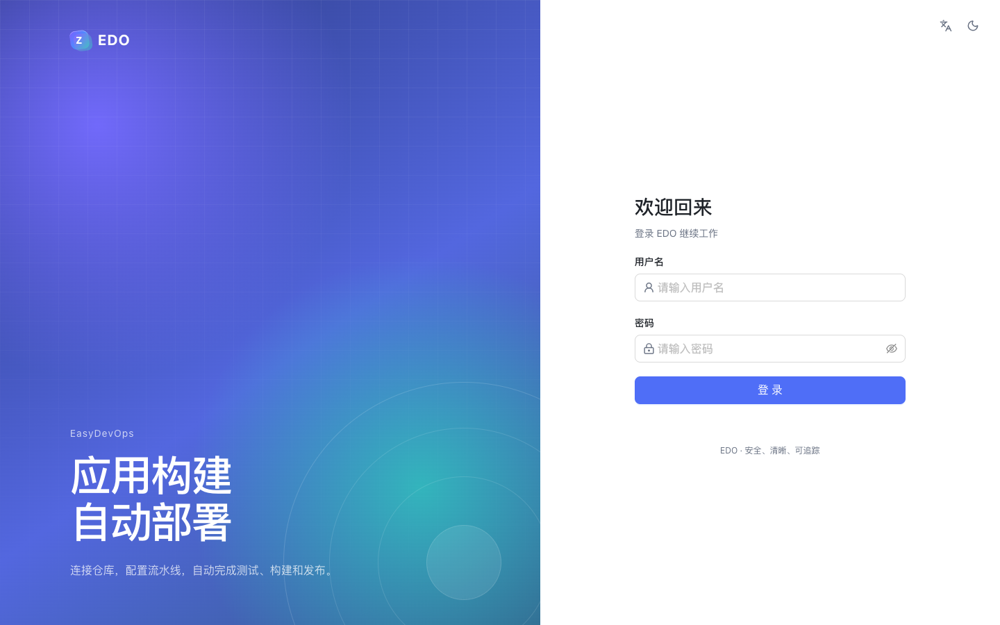
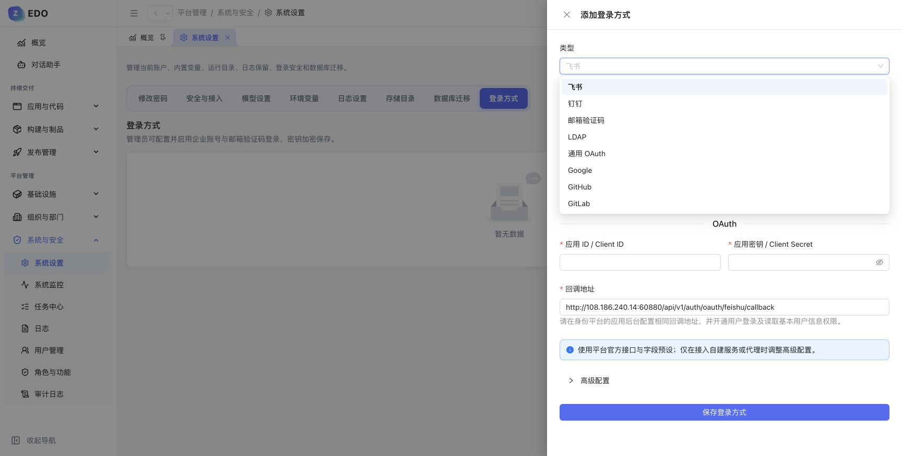
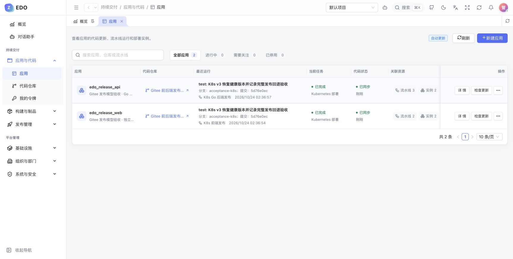
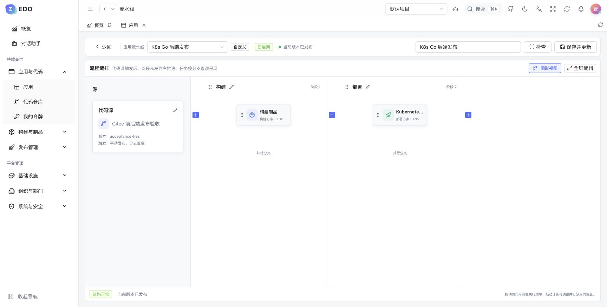
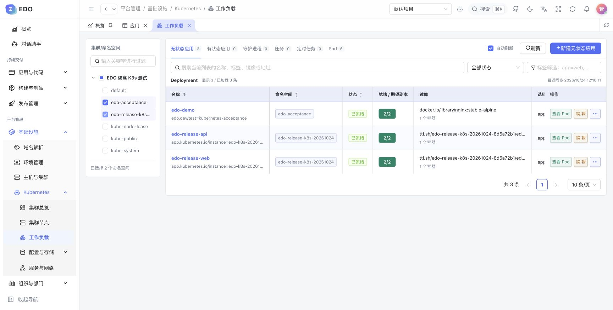
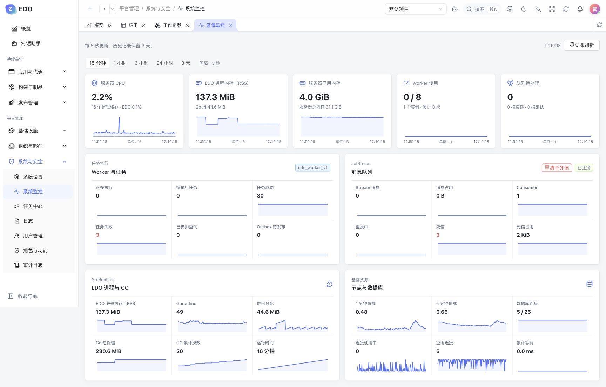

# EDO

EDO（EasyDevOps）是一个简单、轻量的自动发布工具，可以装在自己的电脑或公司内网服务器上，适合中小团队自己部署和使用。

把代码仓库接进来，选好分支，配好测试、打包和部署步骤。以后提交代码，EDO 就会按这些步骤自动执行，每一步的进度、日志和结果都能在页面上看。流水线可以从已有方案开始，再按自己的需要调整。

默认采用 Pull 模式：EDO 按设置的间隔主动检查仓库里的分支、Tag 和 PR/MR，发现符合流水线规则的变化就自动执行。仓库不需要反过来连接 EDO，适合放在内网运行；EDO 需要能访问代码仓库和发布目标。也可以接入 Webhook，更快收到仓库变化。

EDO 的前端和后端打包在一个程序里，网页服务和后台任务在同一个进程里运行。默认用 SQLite 保存数据，数据库就是本地的一个文件。另外还需要 Redis 和 NATS，用 Docker Compose 可以一起启动这些服务。

应用可以直接发布到 EDO 的本地 Docker 环境，也可以发布到远程主机或 Kubernetes 集群。Docker、Docker Compose 和 Kubernetes 都从应用开始，选择流水线和部署方案，再填好具体位置，统一按「应用 → 流水线 → 部署方案 → 运行资源」发布。

## Docker Compose 部署

准备 Linux 或 macOS，安装 Git、Docker、Docker Compose v2 和 Buildx。Compose 会在镜像中完成编译，并启动 EDO、Redis 和 NATS。

首次部署，先拉取代码并准备配置：

```bash
git clone https://github.com/linabellbiu/edo.git
cd edo
cp .env.example .env
openssl rand -base64 32
```

把生成的密钥填入 `.env` 的 `EDO_SECRETS_KEY`，然后启动：

```bash
docker compose --env-file .env up -d --build
```

访问 [http://127.0.0.1:8080](http://127.0.0.1:8080)。默认只监听本机；部署在服务器上时，通过 HTTPS 反向代理对外提供访问，并开启 WebSocket 转发。

首次部署的管理员账号是 `admin`，初始密码是 `123456`。登录后请修改密码。

查看状态和日志：

```bash
docker compose --env-file .env ps
docker compose --env-file .env logs -f api
```

停止服务，保留数据：

```bash
docker compose --env-file .env down
```

更新时，先在开发机提交修改并推送到 GitHub，再在服务器拉取代码、构建并重新部署：

```bash
git pull --ff-only origin main
docker compose --env-file .env up -d --build
```

## 本地启动

本地开发和编译需要 Go 1.26.10、Node.js 24，以及上面的 Docker 工具。在项目根目录安装 Mage：

```bash
go install github.com/magefile/mage@v1.17.2
```

本地进程模式仅支持 Linux 和 macOS；Windows 请使用 `mage start --docker`，在容器中运行。

如果已经通过 Compose 启动 EDO，请先执行上面的停止命令，再选择下面一种方式。

### 开发模式

```bash
mage start --dev
```

访问 [http://127.0.0.1:5173](http://127.0.0.1:5173)，API 地址为 `http://127.0.0.1:8080`。前后端都在当前终端运行，修改前端后会自动刷新，按 `Ctrl+C` 停止。

这个命令会启动 Redis、NATS 并初始化数据库。如果 `.env` 不存在，Mage 会按模板创建文件并生成密钥；文件已存在时，使用其中的配置。

### 单文件运行

先按上面的方式准备 `.env` 和密钥，再启动 Redis、NATS：

```bash
docker compose --env-file .env -f deploy/compose.dev.yml up -d --wait redis nats
mage start
```

`mage start` 会把前端打进 `bin/edo`，初始化数据库并在后台启动。访问 [http://127.0.0.1:8080](http://127.0.0.1:8080)。

### Mage 启动参数

在项目根目录执行：

```bash
mage start [--dev | --docker] [--server | --web]
```

| 参数 | 用途 |
| --- | --- |
| 不带参数 | 构建内嵌前端的单文件程序，迁移数据库，然后在后台启动 |
| `--dev` | 开发模式，在当前终端运行；启动后端时会先启动 Redis、NATS 并迁移数据库 |
| `--docker` | 使用 `deploy/compose.dev.yml` 构建并在后台启动容器 |
| `--server` | 只启动后端；Docker 模式会同时启动后端依赖 |
| `--web` | 只启动前端，不启动后端及其依赖 |
| `--help` / `-h` | 查看启动参数说明 |

`--dev` 和 `--docker` 不能同时使用。不指定 `--server` 或 `--web` 时默认启动前后端，同时指定两者也会启动前后端。

常见组合：

| 命令 | 用途 |
| --- | --- |
| `mage start --server` | 只构建后端、迁移数据库并在后台启动，不构建前端 |
| `mage start --web` | 构建前端并在后台启动预览服务，默认端口为 5173 |
| `mage start --dev` | 在当前终端运行后端和 Vite，前端支持热更新 |
| `mage start --dev --server` | 开发模式，只在当前终端运行后端 |
| `mage start --dev --web` | 开发模式，只在当前终端运行 Vite |
| `mage start --docker` | 在容器中启动完整开发环境，网页默认端口为 5173 |
| `mage start --docker --server` | 在容器中启动后端、数据库迁移和后端依赖 |
| `mage start --docker --web` | 只启动前端容器，不自动启动后端及其依赖 |

`mage start` 和 `mage start --server` 需要事先启动 Redis、NATS，可使用“单文件运行”中的依赖启动命令。只启动前端时，需要另行启动后端才能使用登录等 API 功能。

### 进程与日志管理

| 命令 | 用途 |
| --- | --- |
| `mage status` | 查看本地服务的 PID、前后台模式、就绪状态及 Compose 服务状态 |
| `mage log --tail 100` | 从本地服务日志最后 100 行开始持续监听，默认行数为 100 |
| `mage stop` | 安全停止 Mage 管理的本地前后端和开发环境前后端容器，保留 Redis、NATS 和数据 |
| `mage kill` | 强制结束上述前后端，用于安全停止超时等情况 |
| `mage migrate` | 迁移 `.env` 指定的数据库，不启动其他服务 |
| `mage help` | 查看常用命令 |
| `mage -l` | 查看全部 Mage 任务 |

本地进程记录保存在 `data/run/`，后台日志保存在 `logs/`。重复启动已运行的本地服务会报错，需要先执行 `mage stop`，再启动。开发模式也可以按 `Ctrl+C` 停止，或在另一终端执行 `mage stop`。

`mage log` 监听本地日志文件，需要系统安装 `tail`。通过 `mage start --docker` 启动的容器请使用 Compose 查看日志：

```bash
docker compose --env-file .env -f deploy/compose.dev.yml logs --tail 100 -f api web
```

## 开始发布

1. 创建应用，关联代码仓库和 Git 凭据。
2. 创建流水线，选择要监听的分支、Tag 或 Pull Request。
3. 配置测试、构建和部署任务，选择部署方案并填写发布位置。
4. 启用流水线，提交代码或手动执行，在运行记录中查看进度和日志。

需要时可以添加变量与密钥、并行检查、测试和覆盖率报告、SQL 检查、安全扫描、数据库变更和环境审核。检查失败会拦住后续任务，结果留在运行记录中。配置方法见[流水线检查与发布保护](docs/delivery-checks.md)。

独立的手动 SQL 变更在“基础设施 → SQL 审计”：提交后自动静态检查，由指定审核人审批，再人工执行或跳过。每项绑定本次发布与目标数据库，成功后不能修改、删除；目前不自动联动流水线。使用方法与权限说明见[手动 SQL 审计](docs/sql-audit.md)。

## 配置与数据

首次启动前选择数据库，默认 SQLite，也可以选择 PostgreSQL 或 MySQL。连接地址、端口和目录在 [.env.example](.env.example) 中都有说明，实际配置保存在 `.env`。

默认数据保存在 `data/`，包括数据库、Redis、NATS、仓库文件和构建制品；本地运行日志在 `logs/`。Compose 中的 EDO 日志保存在 `data/logs/`。

备份时一起保存 `data/` 和 `.env`。`EDO_SECRETS_KEY` 用于解密凭据，请固定保存；更换后将无法读取此前保存的凭据。`.env` 含敏感信息，请勿提交到仓库。

## 界面预览

**登录：使用账号登录，或选择管理员已启用的方式。**



**登录方式：在系统设置中配置并启用飞书、钉钉、邮箱验证码等方式。**



**应用：查看代码更新、最近运行和部署实例。**



**流水线：把构建和部署步骤连起来。**



**Kubernetes：按集群和命名空间查看工作负载。**



**监控：查看资源用量、任务和消息队列。**



## 许可

[AGPL-3.0](LICENSE)
