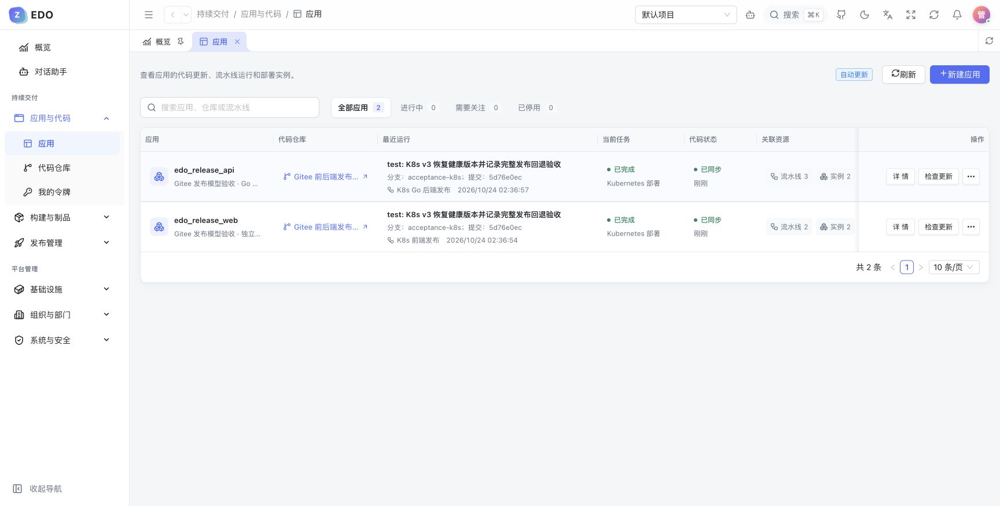
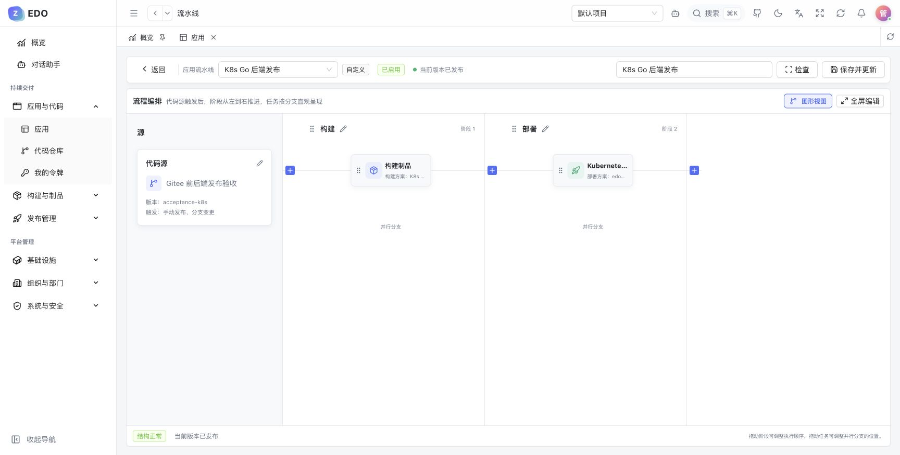
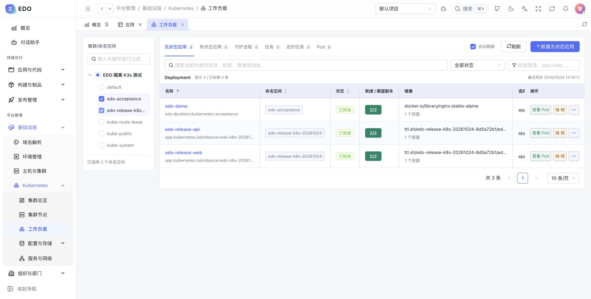
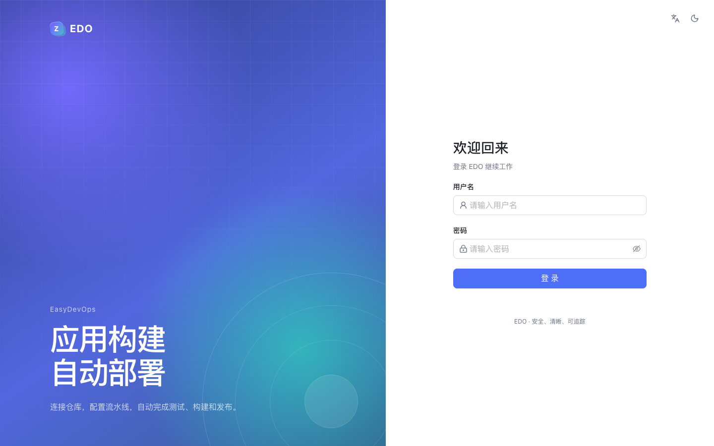
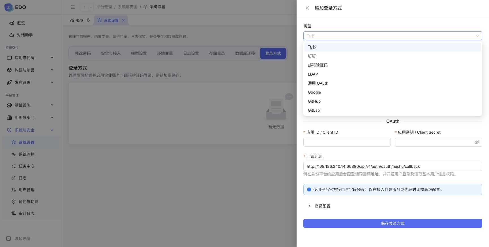
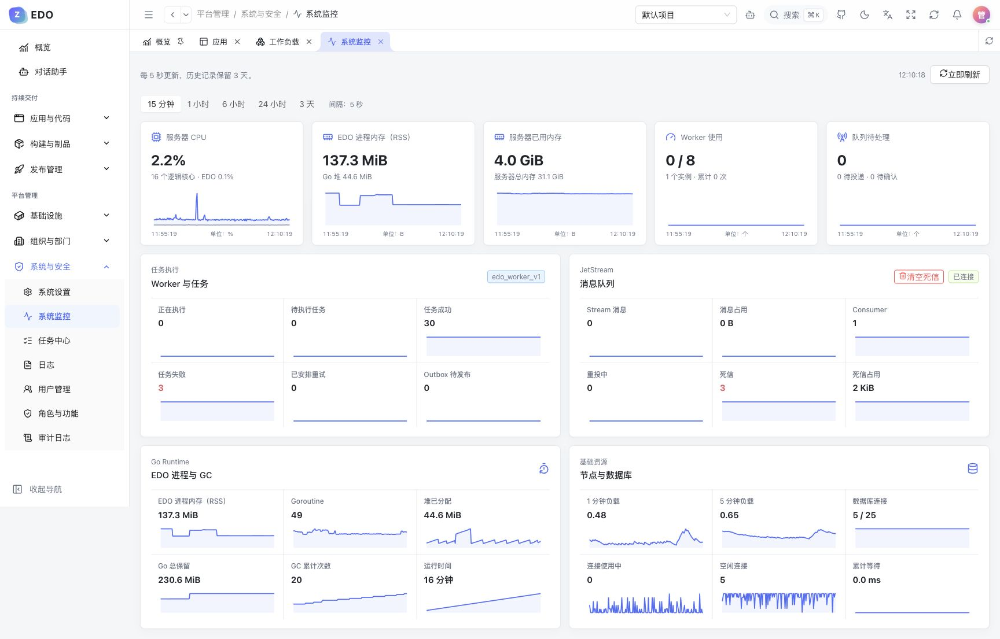

# EDO

EDO（EasyDevOps）是一个简单、轻量的自动发布工具，面向没有专职运维平台团队的中小企业和小型技术团队。可以装在自己的电脑或公司内网服务器上，代码、配置、凭据和发布记录都保存在自己的环境中。

连接代码仓库，选好触发条件，再配置测试、构建和部署步骤。提交代码后，EDO 按流水线执行，在页面上就能查看进度、日志和结果，省去反复手工打包、传文件和登录服务器发布的操作。

[快速开始](#快速开始) · [第一次发布](#第一次发布) · [功能与界面](#功能与界面) · [本地启动](#本地启动) · [文档](#文档)



## 快速开始

支持 Linux 和 macOS。准备好 Git、Docker、Compose v2 或更新版本及 Buildx 插件，确认当前用户可以运行 Docker。macOS 可使用 Docker Desktop。

```bash
git clone --branch main https://github.com/linabellbiu/edo.git
cd edo
cp .env.example .env
docker compose up -d
```

复制后的配置可以直接使用，无需安装 Go、Node.js 或数据库。首次启动会构建前后端镜像，生成并保存随机加密密钥和数据库密码，初始化数据库。镜像及依赖下载需要联网，首次构建请耐心等待。

启动后打开 [http://localhost:8080](http://localhost:8080)。安装在服务器上时，使用 `http://服务器IP:8080`。默认账户为 `admin`，初始密码为 `123456`，登录后从头像菜单修改密码。已有账户不会被覆盖。

检查启动结果：

```bash
docker compose ps -a
curl --fail http://localhost:8080/healthz
curl --fail http://localhost:8080/api/v1/health/ready
```

`bootstrap` 和 `migrate` 是一次性任务，显示 `Exited (0)` 正常，其余服务应保持健康。启动失败时查看日志：

```bash
docker compose logs --tail 100 bootstrap migrate api web
```

端口、镜像源、外部数据库和 HTTPS 配置见[部署说明](docs/deployment.md)。

## 第一次发布

1. 创建应用，关联代码仓库和 Git 凭据。
2. 创建流水线，选择模板，设置分支、Tag 或 Pull Request 等触发条件。
3. 配置测试和构建任务，选择部署方案，填好部署位置。
4. 启用流水线，提交代码，在运行记录中查看执行过程。

默认使用 Pull 模式：EDO 主动检查仓库变化，命中规则后执行流水线。仓库无需访问 EDO，放在内网也能使用；EDO 需要能访问仓库和部署目标。Webhook 可按需开启。

应用可以发布到当前 EDO 的本地 Docker 环境，也可以发布到远程主机或 Kubernetes 集群。多个应用需要一起发布时，可以建立发布计划，选择并行或顺序执行。具体配置见[应用与交付](docs/unified-delivery.md)。

## 功能与界面

### 流水线

从模板开始配置测试、构建和部署，阶段依次执行，同阶段的任务可以并行。需要审核或人工放行时，加入对应任务。每次运行保留代码版本、配置和执行日志，失败后可以按原版本重新执行。

变量、密钥、测试报告和发布检查按需配置，见[流水线检查与发布保护](docs/delivery-checks.md)。



### 主机与 Kubernetes

接入主机后，可以查看 Docker 容器、日志和运行状态。Docker 交互终端需要目标镜像预装会话工具，准备方法见[终端工作区](docs/terminal-workspace.md#docker-受控会话)。

Kubernetes 工作区按集群和命名空间浏览节点、工作负载、配置、存储与网络资源，提供详情、日志和编辑入口。也可以从页面创建原生 K3s 或 k3d 集群：原生 K3s 使用官方安装脚本，k3d 在单台 Docker 主机中创建容器集群。安装前先检测，再核对计划并确认，后台进度可随时重新打开查看。详见 [Kubernetes 管理](docs/kubernetes.md)和 [K3s 安装](docs/k3s-provisioning.md)。



### 团队与权限

按公司、部门和项目组织团队，应用、流水线和发布记录按项目隔离。项目内可以分配不同角色，也可以针对个人限制操作，详见[权限说明](docs/access-control.md)。

管理员可在系统设置中启用飞书、钉钉或邮箱验证码等登录方式，未启用的方式不会出现在登录页。

<details>
<summary>查看登录界面</summary>





</details>

### 系统监控

在 EDO 内查看进程内存、CPU、Go GC、任务、消息队列和数据库连接池的当前值与历史趋势。后台持续采集，历史保留最近 3 天，无需另外安装监控平台。



## 运行与维护

Web 和 Go API 分别运行，Web 提供页面并转发 API 与 WebSocket。Go API 只运行一个进程，同时处理接口和后台任务。

默认 Compose 一起管理 Web、API、PostgreSQL 17、Redis、NATS JetStream 和 Docker 构建器，只有 Web 的 `8080` 端口对外开放。构建器需要特权模式，在独立容器中运行 Docker，通过 mTLS 与 API 通信，不挂载宿主机 Docker Socket。

日常查看状态和日志：

```bash
docker compose ps -a
docker compose logs --tail 100 -f api web
```

更新前先备份，确认没有正在执行的发布任务，再拉取代码并重建镜像：

```bash
git pull --ff-only origin main
git rev-parse --short HEAD
docker compose up -d --build
```

更新后重新检查健康接口和页面。停止服务使用 `docker compose down`，再次启动使用 `docker compose up -d`。

备份时需要保留 PostgreSQL 数据库、整个 `data/` 目录和 `.env`。加密密钥保存在 `data/bootstrap/`，丢失后无法解密已有凭据。数据库使用 `pg_dump` 备份；构建器中部署的应用数据另行备份。不要用 `down -v` 或清空 `data/` 来重启服务。完整步骤见[备份与恢复](docs/deployment.md#备份与恢复)。

## 本地启动

开发环境需要 Go 1.26.10、Node.js 24、npm、Mage 和 Docker 工具，数据库默认使用 SQLite，也支持 PostgreSQL 和 MySQL。

在独立的开发目录中准备配置：

```bash
cp .env.example .env
chmod 600 .env
openssl rand -base64 32
```

把生成的完整值填入 `.env` 的 `EDO_SECRETS_KEY=`，然后启动：

```bash
mage start --dev
```

访问 [http://127.0.0.1:5173](http://127.0.0.1:5173)。这个命令会准备 Redis、NATS，并在当前终端运行前后端，前端支持热更新。修改 Go 源码后需要重启，按 `Ctrl+C` 停止前后端。

本地开发需要手工配置固定密钥，已有环境请保留原密钥和 `.env`。不要在同一数据目录同时运行正式 Compose 与本地后端。Mage 安装、后台运行、完整开发容器及常见问题见[本地开发](docs/development.md)。

## 文档

| 文档 | 内容 |
| --- | --- |
| [部署说明](docs/deployment.md) | Compose、端口与镜像源、数据库、更新和备份 |
| [本地开发](docs/development.md) | 工具安装、Mage 命令、进程管理和启动排查 |
| [应用与交付](docs/unified-delivery.md) | 应用、流水线、构建与部署方案 |
| [流水线检查](docs/delivery-checks.md) | 测试报告、变量与密钥、检查和发布保护 |
| [权限说明](docs/access-control.md) | 组织、项目、角色与个人权限 |
| [Kubernetes](docs/kubernetes.md) | 集群接入、资源管理及相关专题 |
| [终端工作区](docs/terminal-workspace.md) | 主机、容器与 Pod 终端及文件操作 |
| [对话助手](docs/assistant.md) | 默认关闭的开发测试功能，由管理员配置启用 |

## 许可

[AGPL-3.0](LICENSE)
